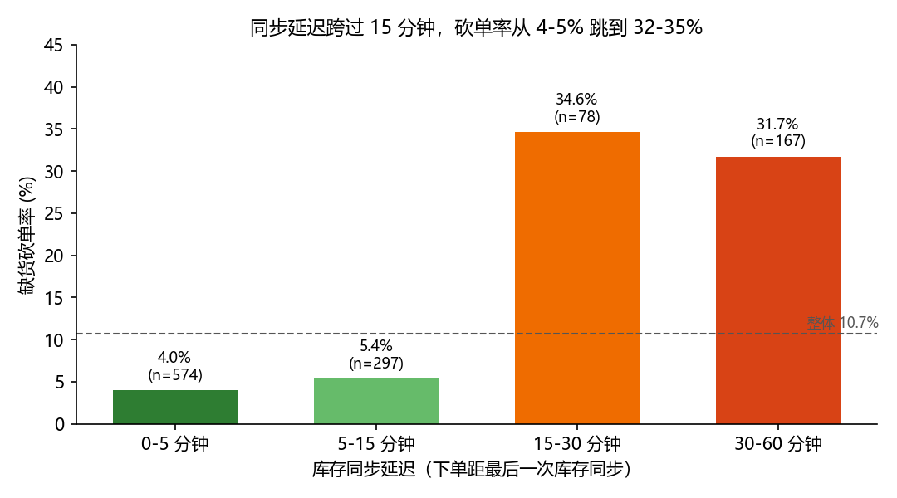
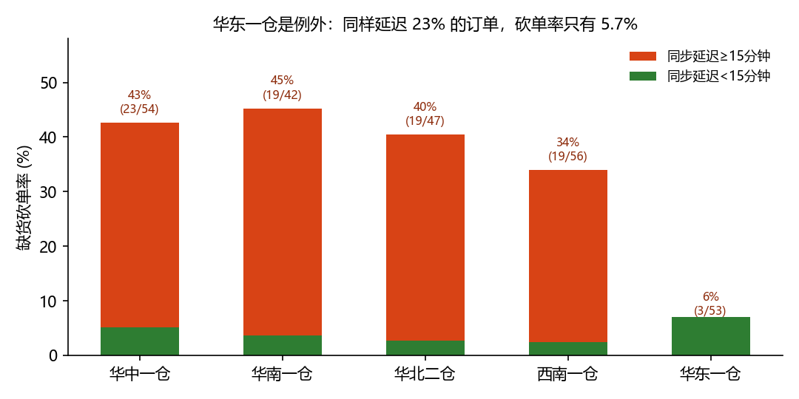
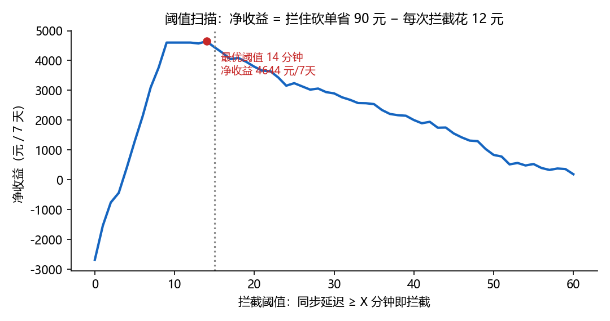

# 缺货砍单归因：问题不在"库存少"，在"库存账本过期了还在用"

**一句话结论**：订单分配时若库存数据已过期 **≥15 分钟**，砍单率从 4.2% 跳到 **32.9%（7.9 倍）**；这 **22.6%** 的订单贡献了 **69.8%** 的砍单。按"延迟≥15 分钟就拦截预警"的规则，**7 天净收益 +4,446 元**（省 7,470 − 花 3,024），折每天 635 元。

---

## 1. 我的判断

### 1.1 先看到三个数据陷阱（不处理会得出错误结论）

| 陷阱 | 现象 | 我的处理 |
|---|---|---|
| **重复行** | 1,220 行里有 **58 条完全重复**（`order_id` 重复），不是 1,220 个独立订单 | 去重 → **1,162 单** |
| **时区不一致** | `order_time` 是 `+08:00`，`stock_synced_at` 是 `UTC(Z)`。直接相减，延迟中位数算出 **485 分钟**，看起来像"库存 8 小时没同步" | 统一转 UTC → 真实延迟中位数 **5 分钟**，最大 60 分钟 |
| **状态未回传** | `is_fulfilled` 有 **46 单为空**，直接 `mean()` 会把它们当 0 算成砍单 | 排除出分母 → 有效样本 **1,116 单** |

> 第 2 条最关键：如果没发现时区问题，会把"8 小时延迟"当成根因去重构同步链路，方向完全错。真实延迟是**分钟级**的，阈值必须落在 15–30 分钟这个量级。

### 1.2 根问题：库存数据在下单那一刻已经失效，系统却仍拿它做分配决策

按同步延迟分桶（`analyze.py` → `output/cancel_rate_by_staleness.csv`）：

| 同步延迟 | 订单数 | 占比 | 缺货砍单率 |
|---|---|---|---|
| 0–5 分钟 | 574 | 51.4% | **4.01%** |
| 5–15 分钟 | 297 | 26.6% | **5.39%** |
| **15–30 分钟** | 78 | 7.0% | **34.62%** |
| **30–60 分钟** | 167 | 15.0% | **31.74%** |



**15 分钟是一道坎**：跨过去砍单率直接跳 6–8 倍，而且 15–30 分钟和 30–60 分钟几乎一样平（34.6% vs 31.7%）。这说明**不是"越旧越糟"，而是"超过某个点，账面库存就完全不可信了"**——延迟 20 分钟和延迟 55 分钟的风险没有区别，救不回来。

### 1.3 最重要的一条反证：库存少不是原因

很多人的第一反应是"缺货当然是因为库存少"。但数据不支持：

- `available_stock` 与砍单的相关系数只有 **-0.016**（几乎为零），分桶后也没有单调关系。
- 按"库存 ≤5 就拦截"这条直觉规则算账：拦 218 单，只拦对 30 单，花 2,616 元省 2,700 元，**7 天净赚 84 元**——基本等于白干。

**所以真正的病灶不是"货不够"，而是"系统看到的货不是真的"**：`available_stock` 记录的是同步那一刻的账面值，延迟越久，这个数字和仓库实际可拣量的偏差越大，分配决策就越像在赌。

### 1.4 一个反例：华东一仓延迟了，但没付代价

| 分仓 | 总砍单率 | 延迟订单占比 | 延迟组砍单率 | 95% 置信区间 |
|---|---|---|---|---|
| 华中一仓 | 14.0% | 23.6% | 42.6% (23/54) | 30.3%–55.8% |
| 华南一仓 | 12.1% | 20.3% | 45.2% (19/42) | 31.2%–60.1% |
| 华北二仓 | 10.3% | 20.3% | 40.4% (19/47) | 27.6%–54.7% |
| 西南一仓 | 10.2% | 24.9% | 33.9% (19/56) | 22.9%–47.0% |
| **华东一仓** | **6.7%** | **23.8%** | **5.7% (3/53)** | **1.9%–15.4%** |



华东一仓的延迟订单占比（23.8%）和其他仓一样高，但延迟组砍单率只有 **5.7%**，和另外四仓的 34–45% **置信区间完全不重叠**——这不是小样本噪音（3/53，Wilson 区间上界才 15.4%）。

**由此得出结论：延迟本身不致命，"延迟之后怎么办"才致命。** 华东一仓大概率在拣货前做了二次校验（或延迟时降级走了别的仓），这是可以直接抄作业的对象。

---

## 2. 我做了什么

**一个可复现的分析 + 一个能调参的看板**，所有数字同源：

```
analyze.py            # 唯一口径来源：清洗 → 分桶 → 策略算账 → 出图
├── output/findings.json        # README 里每个数字都在这里
├── output/*.csv                # 明细表，可逐条核对
└── figures/*.png               # 三张图
app.py                # FastAPI 看板：拖动阈值实时看"省多少 / 花多少 / 净赚多少"
verify.py             # 独立重算 6 条核心断言，核对 README 有没有写错
```

跑起来：

```bash
pip install -r requirements.txt
python analyze.py      # 生成 findings.json 与 figures/
python verify.py       # 逐条核对 README 数字（应全部 PASS）
python app.py          # 看板 http://127.0.0.1:8000
```

---

## 3. 怎么证明有用：把"拦截"当成一笔生意算账

题给口径：**砍单损失 90 元/次**，**拦截预警成本 12 元/次**。所以只要"拦对的砍单"多于"白拦的次数 × 12/90"，就是赚的——盈亏平衡要求准确率 > **13.3%**（12/90）。

四种规则对比如下（`analyze.py` → `output/policy_compare.csv`，7 天口径）：

| 拦截规则 | 拦多少单 | 拦住砍单 | 准确率 | 覆盖率 | 花掉 | 挽回 | **净收益** |
|---|---|---|---|---|---|---|---|
| **B 延迟 ≥15 分钟** | 252 | 83 | 32.9% | 69.8% | 3,024 | 7,470 | **+4,446** |
| E 延迟≥15 或 库存≤5 | 424 | 101 | 23.8% | 84.9% | 5,088 | 9,090 | +4,002 |
| D 延迟 ≥30 分钟 | 171 | 55 | 32.2% | 46.2% | 2,052 | 4,950 | +2,898 |
| C 延迟≥15 且 库存≤10 | 74 | 19 | 25.7% | 16.0% | 888 | 1,710 | +822 |
| A 只按库存 ≤5（直觉规则） | 218 | 30 | 13.8% | 25.2% | 2,616 | 2,700 | **+84** |

**结论：规则 B 净赚 4,446 元/7 天，是直觉规则 A 的 53 倍。** 阈值扫描显示 13–20 分钟区间净收益基本持平（`figures/threshold_sweep.png`），所以我取 **15 分钟**这个整数作为运营可执行的口径，而不是死磕在数学最优的 14 分钟（4,644 元）——差 198 元，换一个能被记住的阈值，值得。



### 3.1 两条建议，按投入产出排序

| 优先级 | 动作 | 7 天收益 | 说明 |
|---|---|---|---|
| **P0（本周可上）** | 分配环节加闸门：`now - stock_synced_at ≥ 15min` 的订单**不直接进拣货**，强制触发一次实时校验/预警 | **+4,446 元**（扣掉 12 元/次成本后净得） | 纯规则配置，不动架构。即使校验失败也不亏：12 < 90 |
| **P1（两周）** | 把同步延迟 P99 压到 15 分钟以内 | **+6,525 元**（72.5 次砍单 × 90，且无需付 12 元拦截费） | 结构性解决，长期更优；但短期做不到，所以 P0 先兜住 |
| **P2（抄作业）** | 复盘华东一仓：延迟 23% 却只砍 5.7% 的做法，复制到另外四仓 | 若四仓都能达到华东水平，延迟组砍单从 80 次降到约 14 次 | 这是最高杠杆的一条，但需要现场调研，不在数据能回答的范围内 |

P0 和 P1 是互补的：P0 治标、立刻止血；P1 治本、把问题消灭。P1 落地后 P0 的拦截量会自然归零，不冲突。

### 3.2 必须说明的边界

- **7 天样本、单一时间窗**，环比与季节性无法验证；年化数字（约 23 万）是线性外推，**只做量级参考，不作为承诺**。
- **拦截成本 12 元/次是题给口径**，本报告没有验证它对每个仓是否一致；若某仓成本更高，盈亏平衡点（13.3%）会相应上移，规则 B 仍然远高于平衡线。
- **`is_fulfilled` 的 46 单"未回传"被排除**。如果这些单实际大量砍单，整体砍单率会被低估；但延迟组的结论基于 252 vs 864 的组间对比，只要未回传不是集中在延迟组，结论稳健。
- **相关性不等于因果**：延迟与砍单的强关联可能部分来自"大促高并发时既延迟又缺货"的共同原因。但 15 分钟处的**突变**（不是渐变）更像机制性失效，而不是共因——这也是我把 P0 定为规则闸门、并建议用华东一仓做对照的原因。

---

## 4. 数据来源

`data/fulfillments.csv`：题目发放的原始数据，1,220 行，未做任何人造数据补充。所有派生字段（`staleness_min`、`status`）均由 `analyze.py` 现场计算，不含手工填写的数字。
